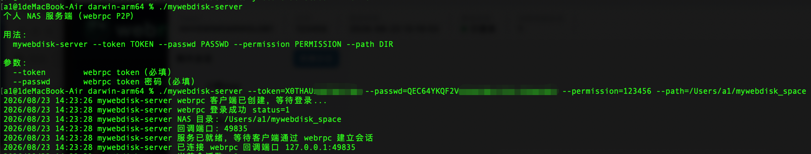
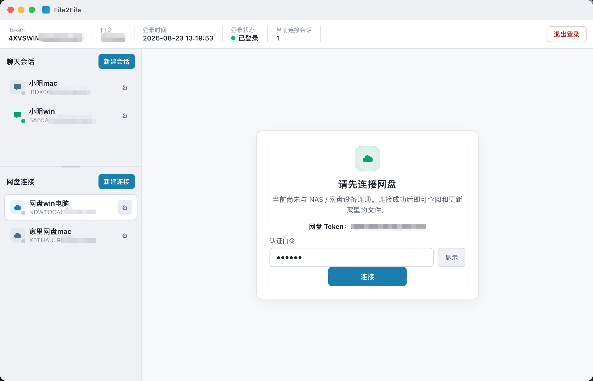
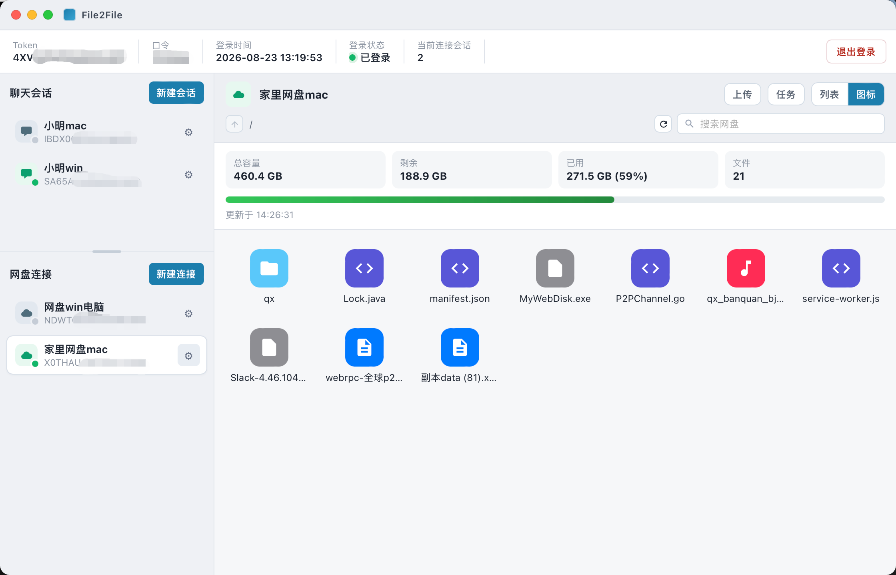

# MyWebDisk

**Personal NAS / private cloud drive without a public IP** — P2P file access over [webrpc](https://www.webrpc.cn/controllor.html)

Run a small Go server on a home Mac, Windows PC, Linux box, or ARM NAS. From another network, open [File2File](https://github.com/xiaoming-software/File2File-Desktop) to browse, upload, and download files that stay on *your* disk. No public IP, no router port mapping, no upload-to-someone-else’s cloud.

[简体中文](README.md)

**Keywords:** personal NAS, private cloud drive, no public IP, P2P file server, webrpc, File2File, macOS, Linux, Windows, Raspberry Pi, ARM NAS

---

## Contents

- [What problem it solves](#what-problem-it-solves)
- [Features](#features)
- [How it works](#how-it-works)
- [Screenshots](#screenshots)
- [What you need](#what-you-need)
- [Deploy on each platform](#deploy-on-each-platform)
- [Start the server](#start-the-server)
- [Connect with File2File](#connect-with-file2file)
- [Build from source](#build-from-source)
- [Security](#security)
- [FAQ](#faq)
- [Related projects](#related-projects)

---

## What problem it solves

Turn a machine you already own into a **personal NAS**:

| Approach | Pain | MyWebDisk |
| --- | --- | --- |
| Public cloud drive | Files leave your disk; quota and privacy limits | Files stay under the directory you pass to `--path` |
| Public IP + port map / frp | Many ISPs give no public IPv4 | webrpc handles NAT traversal |
| Expose WebDAV / SMB | Open ports, TLS, firewall | Peers must know both the Token and the passphrase |

Typical use: reach photos and docs while traveling, pull an installer from home, or run a private drive for yourself.

---

## Features

One command starts the server. After File2File connects you can:

- **Browse** folders (list or icon view). Paths are sandboxed under `--path` (no `../` escape)
- **Disk stats**: total, free, used, file count
- **Upload / download** (chunked for large files)
- **Create, rename, move, delete** files and folders
- **Search** by file name
- **Zip** a folder (with progress)

The webrpc runtime is **embedded**. You do not ship extra `.so` / `.dylib` / `.dll` files next to the binary.

---

## How it works

1. On the home machine, start `mywebdisk-server` with that device’s webrpc **token, password, passphrase**, and a local folder.
2. The process logs into webrpc and waits on the local callback port.
3. On the remote machine, sign into File2File with a **different** token.
4. Under **Web disk connections**, enter the *server* token and the same passphrase to open a P2P session.
5. List / upload / download travel on that encrypted path. webrpc does not store your file payloads.

Both sides need outbound Internet for the handshake. Payload transfer prefers a direct peer path.

---

## Screenshots

### 1. Server running at home

After token, password, passphrase, and NAS path are set, a successful login looks like this:



### 2. File2File before the disk is linked

Once File2File itself is logged in, pick a node under **Web disk connections**. The dialog asks for the **NAS token** and **auth passphrase** (must match server `--permission`):



### 3. After a successful link

Disk usage, search, upload, and the home file tree:



---

## What you need

1. **Two webrpc tokens** (one for the server, one for File2File).  
   Register at the [webrpc console](https://www.webrpc.cn/controllor.html) and copy **Token** plus **password** from My Tokens.
2. **Passphrase (`permission`)**  
   Set it on the server. File2File must send the same value when connecting the disk. Do not leave it empty.
3. **A local folder**  
   Examples: `/Users/you/mywebdisk_space`, `D:\nas`, `/mnt/data/nas`. Created if missing.
4. **Client app**  
   [File2File Desktop](https://github.com/xiaoming-software/File2File-Desktop).

---

## Deploy on each platform

Prebuilt single-file binaries live in [`dist/`](dist/):

| Platform | Arch | Path in this repo | Typical hardware |
| --- | --- | --- | --- |
| macOS 11+ | Apple Silicon (arm64) | [`dist/darwin-arm64/mywebdisk-server`](dist/darwin-arm64/mywebdisk-server) | M-series Mac |
| Linux | x86_64 (amd64) | [`dist/linux-amd64/mywebdisk-server`](dist/linux-amd64/mywebdisk-server) | x86 NAS / mini PC |
| Linux | ARM64 | [`dist/linux-arm64/mywebdisk-server`](dist/linux-arm64/mywebdisk-server) | Raspberry Pi 64-bit, ARM NAS |
| Windows 10/11 | x64 | [`dist/windows-amd64/mywebdisk-server.exe`](dist/windows-amd64/mywebdisk-server.exe) | Home Windows PC |

No extra webrpc SDK install is required.

### macOS (Apple Silicon)

```bash
chmod +x dist/darwin-arm64/mywebdisk-server
./dist/darwin-arm64/mywebdisk-server \
  --token=SERVER_TOKEN \
  --passwd=TOKEN_PASSWORD \
  --permission=PASSPHRASE \
  --path=/Users/you/mywebdisk_space
```

If Gatekeeper blocks the binary: System Settings → Privacy & Security, or:

```bash
xattr -dr com.apple.quarantine dist/darwin-arm64/mywebdisk-server
```

### Linux x86_64

```bash
chmod +x dist/linux-amd64/mywebdisk-server
./dist/linux-amd64/mywebdisk-server \
  --token=SERVER_TOKEN \
  --passwd=TOKEN_PASSWORD \
  --permission=PASSPHRASE \
  --path=/mnt/data/nas
```

Example systemd unit for a always-on NAS:

```ini
# /etc/systemd/system/mywebdisk.service
[Unit]
Description=MyWebDisk personal NAS (webrpc P2P)
After=network-online.target

[Service]
Type=simple
ExecStart=/opt/mywebdisk/mywebdisk-server --token=TOKEN --passwd=PASSWD --permission=PIN --path=/mnt/data/nas
Restart=on-failure
RestartSec=5

[Install]
WantedBy=multi-user.target
```

```bash
sudo systemctl daemon-reload
sudo systemctl enable --now mywebdisk
```

### Linux ARM64 (Raspberry Pi / ARM NAS)

```bash
chmod +x dist/linux-arm64/mywebdisk-server
./dist/linux-arm64/mywebdisk-server \
  --token=SERVER_TOKEN \
  --passwd=TOKEN_PASSWORD \
  --permission=PASSPHRASE \
  --path=/mnt/usb/nas
```

Use a **64-bit** OS image. 32-bit ARM is not published.

### Windows x64

```bat
dist\windows-amd64\mywebdisk-server.exe --token=SERVER_TOKEN --passwd=TOKEN_PASSWORD --permission=PASSPHRASE --path=D:\nas
```

Keep the process running. For boot start, use Task Scheduler or a service wrapper (e.g. nssm).

---

## Start the server

All four flags are required:

| Flag | Meaning |
| --- | --- |
| `--token` | webrpc token for this NAS host |
| `--passwd` | password of that token in the console |
| `--permission` | passphrase; File2File “auth passphrase” must match |
| `--path` | local folder used as the drive root (created if needed) |

Healthy logs look like:

```text
webrpc client created, waiting for login...
webrpc login ok status=1
NAS directory: /Users/a1/mywebdisk_space
ready; waiting for webrpc sessions
connected to webrpc callback 127.0.0.1:xxxxx
```

(Chinese log lines are what the binary actually prints.) Wait until **ready** before opening File2File. Wrong credentials time out in about 30 seconds. Stop with `Ctrl+C`.

---

## Connect with File2File

Client repo: [xiaoming-software/File2File-Desktop](https://github.com/xiaoming-software/File2File-Desktop)

1. Install File2File (macOS / Windows / Linux).
2. Log in with the **client** webrpc token and password. File2File’s own optional login passphrase is *not* the NAS passphrase.
3. In the sidebar, open **Web disk connections** → **New connection** (or a saved node).
4. In **Connect to disk**, enter:
   - **Disk token**: server `--token`
   - **Auth passphrase**: server `--permission`
5. Click **Connect**. You should see usage stats, the file grid, upload, and search.

The server must already be online. Token alone is not enough if the passphrase is wrong.

---

## Build from source

Requires Go 1.22+. Platform webrpc libraries are in `sdk/`.

```bash
git clone https://github.com/xiaoming-software/mywebdisk.git
cd mywebdisk
./build.sh
```

Outputs:

```text
dist/darwin-arm64/mywebdisk-server
dist/linux-amd64/mywebdisk-server
dist/linux-arm64/mywebdisk-server
dist/windows-amd64/mywebdisk-server.exe
```

On an Apple Silicon Mac, `./build.sh` cross-compiles all four (`CGO_ENABLED=0`, no zig).

---

## Security

- The passphrase gates who may `OpenSession` to this NAS. Use a long random value; never commit it.
- File APIs cannot walk outside `--path`.
- Transport is encrypted by webrpc. The platform does not host your file contents.
- Lawful use only. See the [webrpc compliance notice](https://www.webrpc.cn/controllor.html).
- Token + password + passphrase are the keys to the drive. Do not share them with people you do not trust.

---

## FAQ

**Can I run this without a public IP?**  
Yes. That is the main design point. Both peers need outbound Internet for the handshake.

**Should File2File and the server share one token?**  
No. One token on `mywebdisk-server`, another on File2File. When linking the disk, type the *server* token and passphrase into the client dialog.

**Login keeps timing out.**  
Copy token/password from My Tokens without extra spaces, confirm outbound network, and use the binary that matches the OS/arch.

**Connect-to-disk fails.**  
Server log must show ready, the process must still be running, passphrase must equal `--permission`, and the client must be logged in.

**Intel Mac / Android / iOS server?**  
Published builds: darwin-arm64, linux-amd64, linux-arm64, windows-amd64. Mobile OS is not a server target. Intel Mac is not in the prebuilt set.

**Multi-user shared drive?**  
Several File2File clients can talk to one server, but this is built as a **personal NAS**: anyone with token + passphrase can change that folder. Share those secrets only on purpose.

---

## Related projects

| Project | Role |
| --- | --- |
| **MyWebDisk** (this repo) | Personal NAS server |
| [File2File Desktop](https://github.com/xiaoming-software/File2File-Desktop) | Desktop client that connects to the disk (also chat and direct file send) |
| [webrpc](https://www.webrpc.cn/controllor.html) | P2P RPC transport and tokens |

Open an Issue in this repository for bugs and ideas. Keep your tokens and passphrase private.
